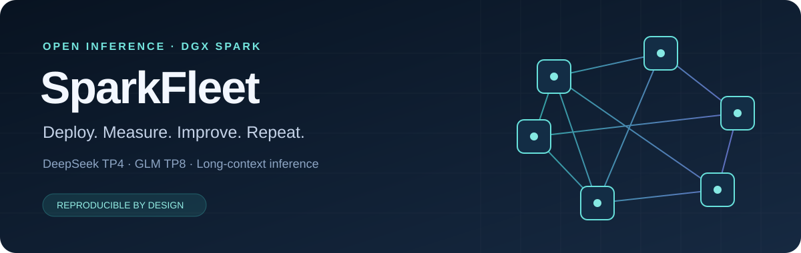

<p align="center"></p>

<p align="center"><a href="README.md">English</a> · <a href="https://github.com/sumsliu/spark-fleet/actions/workflows/ci.yml">自动测试</a> · Apache-2.0 · v0.1 Alpha</p>

# 让多机 Spark 推理部署可以复用

**SparkFleet 把 DeepSeek 与 GLM 的多机部署、长上下文优化、接口验收和回滚经验，整理成可以审阅、复现、共同完善的开源工具。**

面向 Linux ARM64 **DGX Spark / GB10 / SM121**，提供 **DeepSeek V4.1 Flash 四机 TP4**、**GLM 5.3 八机 TP8** 两套独立参考配置，保留各自的原生权重、KV 格式和推测解码设置。支持 OpenAI 兼容接口、Anthropic Messages 协议与经过验收才启用的统一网关。

**当前为 v0.1 Alpha。** 补丁和历史数据来自已有集群；新整理的控制器经过 CPU 模拟测试，尚未在一套全新 GPU 集群上完整复现。需要自行准备兼容镜像与合法取得的权重。普通最新版 vLLM 不能直接替代我们的专用运行时。先阅读[运行时要求](docs/runtime.md)。

## 为什么值得一起做

实际开发中，模型的体验远不止一个生成速度数字。十几万 token 的对话每轮重新计算、冷输入挡住热请求、工具调用格式不兼容、菜单里有模型但接口不能用，都会让一套看似部署成功的集群难以使用。

这个项目把这些问题变成可检查的配置、测试和实验记录：

- **长对话缓存与并发体验。** 保留前缀缓存、预填充竞争调度的实现与边界说明。
- **模型分开适配。** DeepSeek 的 DSpark、B12X、磁盘 Engram，与 GLM 的 MTP、Marlin、FP8 MLA 分别管理。
- **用数据决定上线。** 成对测速、置信区间、基线漂移检查，另做正确性验收；微测提速不能代替整机收益。
- **操作可追溯。** 配置预览、镜像与源码摘要、启动身份、四把锁、温度和内存保护、只停止自己创建的容器。
- **接口真实可用。** 可选 mTLS 网关检查验收记录，未通过的模型不出现在目录中。
- **失败经验也公开。** Engram 并发、动态草稿长度、并行前缀等未获得稳定收益的方案，说明为什么没有采用。

## 我们实际测到过什么

以下是**原部署的历史参考数据**，不是安装本版本后在新集群重跑的成绩。各行工作负载不同，不能拼成一个通用速度承诺。

| 场景 | 修复前 → 修复后 | 说明 |
|---|---:|---|
| 约 2.5 万 token，生成 1,024 token 后重复请求 | 约 10 秒 → 0.5 秒；命中率 0 → 99.5% | 每 1,024 token 保留前缀 |
| 约 10.5 万 token 冷输入处理中，加入高命中请求 | 首 token 40.63 秒 → 4.99 秒 | 冷请求该次 45.73 → 46.26 秒，代价一并报告 |
| 12 组成对自然结束测试 | 加权解码 48.89 → 51.08 token/s | Tail-v3；成对几何收益 4.56%，95% 区间 1.92–7.21% |
| 热缓存 32K 输入、固定 768 输出、4 并发 | **合计** 85.70 → 92.77 token/s | 不是单路速度 |

[来源与限制](benchmarks/reference/README.md) · [结构化结果](benchmarks/reference/results.json)。**单路 100 token/s 仍是目标，尚未证明达到。** 配置支持 256K 窗口与最高 32K 输出预算，不代表 256K 输入还能另加 32K 输出；两者共享窗口，完整压力与质量测试需在目标集群完成。

## 先试配置，不碰集群

控制端需要 Python 3.11+；真正运行模型需要 Linux ARM64 Spark 节点。

```sh
git clone https://github.com/sumsliu/spark-fleet.git
cd spark-fleet
python3 -m venv .venv
. .venv/bin/activate
python -m pip install -e .
sparkfleet init --profile deepseek-tp4 --out cluster.json
sparkfleet validate cluster.json --template
sparkfleet render cluster.json --template --out work/preview
```

这几步只生成示例和供审阅的命令，不连接集群。GLM 使用 `--profile glm-tp8`。按[快速开始](docs/quickstart.md)替换节点、镜像摘要、权重路径和网卡信息后，再做只读检查、生成计划和受保护启动。

## 文档入口

| 需求 | 文档 |
|---|---|
| 新集群部署 | [快速开始](docs/quickstart.md)、[运行时要求](docs/runtime.md)、[两套模型配置](docs/recipes.md) |
| 理解优化与失败原因 | [推理拆解与优化经验](docs/optimization.md)、[补丁说明](overlays/README.md) |
| 核实 200G | [网络测量](docs/network.md) |
| 接入家中电脑或开发客户端 | [接口与客户端](docs/clients.md)、[网关](docs/gateway.md) |
| 验收、升级与回滚 | [验收矩阵](docs/acceptance.md)、[测速方法](docs/benchmarking.md)、[运维与回滚](docs/operations.md) |
| 参与完善 | [贡献指南](CONTRIBUTING.md)、[路线图](ROADMAP.md)、[架构](docs/architecture.md) |

## 欢迎一起把它做得更好

如果你有 Spark 集群，欢迎贡献独立复现、完整镜像构建步骤、长对话工具调用测试，或者测清每条链路的 RDMA/NCCL 带宽。失败的实验同样有价值：它能帮别人省下几小时甚至几天。

我们希望每个“更快”都附上可复现的条件，每个“部署成功”都有真实请求作为证据。使用[测速报告模板](https://github.com/sumsliu/spark-fleet/issues/new?template=benchmark.yml)，或到[讨论区](https://github.com/sumsliu/spark-fleet/discussions)交流。请先删除密钥、私有地址和真实对话。

项目采用 Apache-2.0；上游补丁保留许可证与修改说明。权重、CUDA 组件和 Claude 等商业客户端不包含在内，也不转授其许可。项目独立维护，非相关厂商官方项目。
