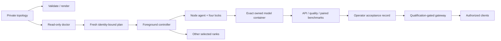

# Architecture

The control plane is Python 3.11+ with a standard-library core. Node agents are staged as a standalone source file and run under the operator's authenticated Linux account. Model runtimes and weights stay separate from the controller package. A topology selects one model fleet at a time.

`render` is deterministic argv generation. `doctor` is observation. `plan` binds fresh node/image/source observations. `run --execute` is the only CLI cluster mutation path; it does not upgrade or adopt an existing service. Receipts stay local/private.

API acceptance and benchmarks are independent clients. They never mutate a model service or silently switch versions. The benchmark's stable-positive evidence is a measurement result; an operator performs promotion with a recoverable recipe.

The optional gateway depends on aiohttp. It forwards only fixed configured endpoints, authenticates device certificate plus key, and hides disabled/unqualified models. It does not grant OS/tool permissions or implement a desktop application's child agents.

Reference overlays are full source-file replacements with exact preimages and notices. They remain in the checkout, outside the installed CLI package. They must be verified/materialized explicitly; installing the CLI never patches vLLM.

## Trust and limits

The operator controls the config, model images, SSH keys, node Docker administration, PKI and acceptance records. Plan SHA256 detects unintended content changes; it is not an authorization service or adversarial signature. All launchers must share the same lock contract. A network partition can prevent confirmed cleanup, which remains an incident requiring inspection. v0.1 does not claim a distributed hardware-fencing protocol.

The public repository is a clean export. It contains no deployment credentials, real machine addresses, model binaries, proprietary client bundles, raw conversations, historic one-use authority or original private repository history.
